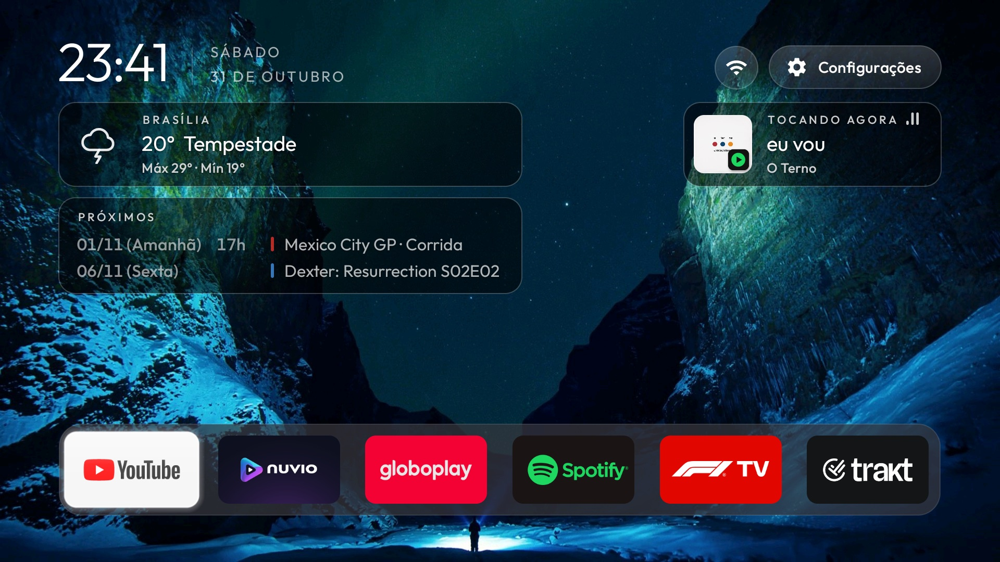

# Chromecast Home: Up next, Now playing controls and weather



A fork of this repo's launcher, tuned on a Chromecast with Google TV 4K (sabrina, Google TV 14). It
branches from upstream `c1da7e10` (21 Oct 2026) and changes only `launcher/`; everything else is
upstream as it was then.

## What it adds

**Up next.** A card under the weather that reads iCalendar feeds from the theme's `agenda_calendars`
(`https://` or `webcal://`), refreshed once an hour while Home is on screen:

- F1: every session of the next Grand Prix weekend, shown from the Monday of race week, with its time.
- Series: the next episode of each show within 30 days, one row per show (made for an
  [Episodate](https://www.episodate.com) watchlist feed; other feeds show their events as they are).
- One table row per event: date and weekday ("Today", "Tomorrow"), time for F1, title. A red bar marks
  F1, a blue one a series; later days are dimmed.

**Now playing.** The card shows the playing app's icon on the cover, and sound bars in Spotify green
while Spotify plays. It can be focused (Up from the dock): OK opens a small bar with previous,
play/pause, next and the app's own icon to open it; Up or Down closes it. A paused track stays on the
card for 30 minutes, marked Paused, so it can be resumed. The screen stays on while a track plays.

**Weather.** Open-Meteo for the theme's `weather_city`, `weather_latitude` and `weather_longitude`.
With `weather_metar` (an ICAO airport code) the "now" comes from that airport's latest METAR, a real
observation, and falls back to the model when it is missing or older than 90 minutes.

**Tiles.** Hold OK on a tile for Move, Remove from Home, Uninstall and App info, as on the stock
Google TV home.

**Back out of Spotify (opt-in).** On Spotify's own home, Back asks "Close Spotify?" and closing stops
the music. With `SPOTIFY_EXIT_SERVICE=1`, an accessibility service sends you Home instead, and the
music keeps playing. It only watches `com.spotify.tv.android`, and only reacts to the Back key there.

## Theme settings

```json
{
  "wallpaper_rotation_minutes": 15,
  "weather_city": "Curitiba",
  "weather_latitude": -25.43,
  "weather_longitude": -49.27,
  "weather_metar": "SBCT",
  "agenda_calendars": [
    "https://files-f1.motorsportcalendars.com/f1-calendar_qualifying_sprint_gp.ics",
    "webcal://www.episodate.com/user/calendar?id=YOUR_ID&key=YOUR_KEY"
  ]
}
```

An Episodate calendar link carries a private key: keep your theme's `config.json` out of any public
repository once it has one.

## Permissions and network

This fork adds what upstream's launcher does not have:

- `INTERNET`, used only while Home is on screen: Open-Meteo every 30 minutes (coordinates only), the
  METAR from aviationweather.gov if set, and the `agenda_calendars` URLs once an hour. No telemetry.
- A notification listener (`NowPlayingListener`) to read media sessions for Now playing;
  `build-and-install.sh` grants it with `cmd notification allow_listener`.
- `REQUEST_DELETE_PACKAGES` for Uninstall in the tile menu.
- `SpotifyExitService`, an accessibility service that filters keys and reads Spotify's window; it is
  only enabled with `SPOTIFY_EXIT_SERVICE=1`.

## Build

As upstream: `TV_HOST=<ip> launcher/build-and-install.sh`, plus `SPOTIFY_EXIT_SERVICE=1` for the
Spotify service. Android turns accessibility services off when an app is reinstalled, so pass the flag
on every install.
